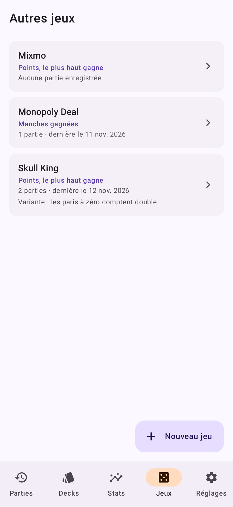
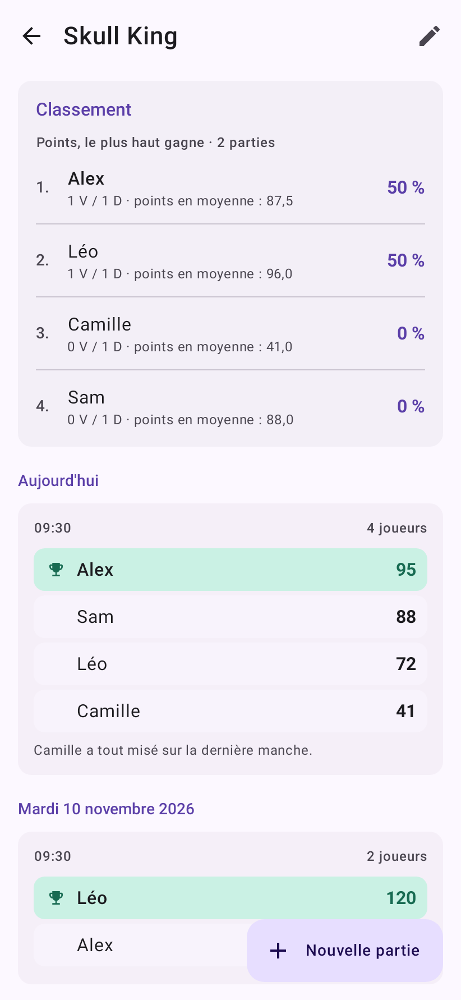
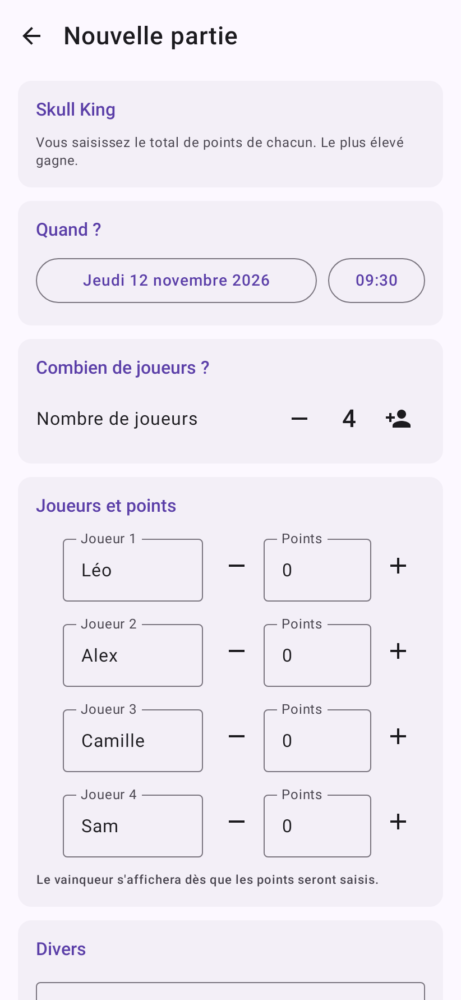

# MTG Duel

Application Android personnelle pour tenir l'historique de vos parties. Deux sections indépendantes :

- **Magic: The Gathering**, en duel à deux joueurs, avec les decks et les points de vie ;
- **Autres jeux**, où vous créez vos propres jeux (Skull King, Mixmo, Monopoly Deal…) et enregistrez
  des parties avec autant de joueurs que vous voulez.

Pas de compte, pas de store : un simple APK à installer, et les données restent sur le téléphone —
avec une synchronisation facultative entre deux appareils via votre propre serveur.

## Ce que l'app enregistre

Pour chaque partie :

- **la date et l'heure** ;
- **le format** (Commander, Standard, Limité, Autre) et les **PV de départ** ;
- **qui a commencé** la partie ;
- **le deck joué par chacun** ;
- **le vainqueur** ;
- **les PV restants de chaque joueur à la fin**, et en particulier ceux du perdant au moment de la défaite ;
- la façon dont la partie s'est terminée (dégâts, dégâts de commandant, poison, plus de cartes, abandon,
  victoire alternative, autre), le nombre de tours et des notes libres — tous optionnels.

## Aperçu

| Historique Magic | Statistiques Magic | Saisie d'une partie Magic |
| --- | --- | --- |
|  |  |  |

| Liste des jeux | Classement d'un jeu | Partie à plusieurs |
| --- | --- | --- |
|  |  |  |

## Les écrans

| Onglet | Contenu |
| --- | --- |
| **Parties** | Le score global entre vous deux, l'historique groupé par jour, un filtre par deck. Un appui sur une partie permet de la corriger ou de la supprimer. |
| **Decks** | Vos decks, classés par propriétaire, avec leurs couleurs et leur bilan victoires/défaites. Un deck déjà utilisé peut être archivé (il disparaît des nouvelles saisies mais reste dans l'historique). |
| **Stats** | Bilan global, avantage réel du joueur qui commence, statistiques par joueur (dont PV restants moyens en victoire et en défaite, meilleure série), classement des decks et confrontations deck contre deck. |
| **Jeux** | Vos autres jeux. Chaque jeu a son classement, l'historique de ses parties, et son mode de comptage. |
| **Réglages** | Les noms des deux joueurs, la synchronisation, l'export/import de sauvegarde JSON, l'effacement de l'historique. |

La saisie d'une partie est optimisée pour l'après-match : les decks de la partie précédente sont
pré-sélectionnés, et choisir le vainqueur remplit automatiquement les PV (PV de départ pour le gagnant,
0 pour le perdant) tant que vous n'avez pas modifié ces champs à la main.

## Installer l'APK

1. Copiez `app-release.apk` sur le téléphone (câble USB, Drive, mail…).
2. Ouvrez le fichier depuis le gestionnaire de fichiers.
3. Android demandera d'autoriser l'installation d'applications provenant de cette source : acceptez
   (*Paramètres → Applications → Accès spécial → Installer des applis inconnues*).
4. Installez. L'application s'appelle **MTG Duel**.

Android 8.0 (API 26) minimum.

## Les données

Tout est stocké dans un fichier JSON du dossier privé de l'application sur le téléphone. Rien ne sort
de l'appareil.

- **Exporter** (Réglages → Sauvegarde) écrit un fichier `mtg-duel-AAAA-MM-JJ.json` où vous voulez.
- **Importer** propose soit de *remplacer* toutes les données, soit de *fusionner* (seules les parties et
  les decks absents sont ajoutés) — pratique pour changer de téléphone ou récupérer la saisie faite sur
  l'autre appareil.

## Les autres jeux

La section **Jeux** est complètement séparée de Magic : ni decks, ni points de vie, ni notion de
joueur qui commence.

### Créer un jeu

Un nom, et surtout **comment on compte les points** — c'est ce réglage qui désigne le vainqueur de
chaque partie :

| Mode | Usage | Exemple |
| --- | --- | --- |
| **Manches gagnées** | Une manche gagnée vaut un point, vous arrêtez quand vous voulez. | Monopoly Deal |
| **Points, le plus haut gagne** | Vous saisissez le total de chacun. | Skull King |
| **Points, le plus bas gagne** | Idem, mais le plus petit total l'emporte. | Jeux à pénalités |

Ce réglage reste modifiable : le changer recalcule les vainqueurs des parties déjà enregistrées,
et l'écran le signale.

### Enregistrer une partie

Vous fixez le **nombre de joueurs** (2 à 12), saisissez un nom et un score par joueur, et le
vainqueur s'affiche au fur et à mesure. Les noms sont libres, donc un invité de passage se note
sans rien configurer ; les noms déjà utilisés sont proposés en suggestion, et deux joueurs ne
peuvent pas porter le même nom dans une partie. Les égalités sont détectées et affichées.

Chaque jeu tient son **classement** : parties jouées, victoires, défaites, égalités, taux de
victoire et score moyen, trié par nombre de victoires.

## Synchroniser les deux téléphones

Par défaut l'application est entièrement hors ligne. En option, les deux téléphones peuvent
partager parties, decks et noms de joueurs via **votre propre serveur** : une petite API PHP
(`serveur/sync.php`) posée devant une base PostgreSQL.

### Pourquoi une API et pas la base directement

Faire parler l'application directement à PostgreSQL obligerait à embarquer les identifiants de
la base dans l'APK — donc à les offrir à quiconque récupère le fichier — et à exposer la base sur
Internet. L'API tient dans un fichier, ne connaît qu'un jeton partagé, et c'est elle seule qui
touche à la base.

### Déploiement (exemple avec alwaysdata)

1. **Base** : créez une base PostgreSQL et notez son nom, son hôte, l'utilisateur et le mot de
   passe. La table est créée automatiquement au premier appel (`serveur/schema.sql` la décrit).
2. **Site** : dans *Web → Sites*, un site PHP suffit. Repérez son répertoire racine
   (`~/www` par défaut).
3. **Fichiers** : déposez-y `serveur/sync.php`, et créez à côté un `config.php` :

   ```php
   <?php
   const DB_HOST = 'postgresql-VOTRECOMPTE.alwaysdata.net';
   const DB_PORT = 5432;
   const DB_NAME = 'nom_de_votre_base';
   const DB_USER = 'votre_utilisateur';
   const DB_PASSWORD = 'le mot de passe de la base';
   const SYNC_TOKEN = 'une longue phrase secrète, au moins 16 caractères';
   ```

   `SYNC_TOKEN` est un secret que vous inventez : c'est lui qui autorise vos deux téléphones, et
   lui seul. Choisissez-le long et aléatoire.
4. **Vérification** : ouvrez `https://votre-site/sync.php` dans un navigateur. La réponse attendue
   est `{"error":"Jeton absent ou invalide."}` — cela prouve que PHP et la base répondent.
5. **Application**, sur chaque téléphone : *Réglages → Synchronisation*, renseignez l'adresse
   (`https://votre-site/sync.php`) et le même jeton, puis activez l'interrupteur.

La synchronisation se déclenche au lancement de l'application, quelques secondes après chaque
modification, et à la demande via le bouton *Synchroniser*.

`sync.php` accepte n'importe quelle collection envoyée par l'application : les parties de Magic,
les decks, les jeux et leurs parties, et toute collection ajoutée plus tard sans retoucher le
serveur. Les enregistrements d'une collection que l'un des téléphones ne connaît pas encore sont
conservés intacts, ce qui permet de mettre les appareils à jour l'un après l'autre.

### Comment les conflits sont tranchés

Chaque partie, deck et nom de joueur porte sa date de dernière modification. À la fusion, la
version la plus récente gagne. Les suppressions voyagent sous forme de marqueurs, ce qui évite
qu'une partie supprimée sur un téléphone ne revienne depuis l'autre.

La limite assumée : l'arbitrage repose sur l'horloge des téléphones. Si vous modifiez **la même**
partie chacun de votre côté sans synchroniser entre-temps, la dernière enregistrée l'emporte et
l'autre version est perdue. Pour deux joueurs qui saisissent chacun leurs parties, le cas ne se
présente pas.

Le jeton et l'adresse sont stockés à part des données de jeu : ils ne figurent jamais dans les
sauvegardes exportées.

## Reprendre le projet sur un ordinateur

1. Installez **Android Studio** (gratuit, Windows/macOS/Linux) : <https://developer.android.com/studio>.
   Il apporte le JDK et le SDK Android nécessaires, rien d'autre n'est à installer.
2. Décompressez `mtg-duel-projet.zip` quelque part (par exemple `Documents/Mtg`).
3. Dans Android Studio : **Open** → sélectionnez le dossier décompressé (celui qui contient
   `settings.gradle.kts`) → **Trust Project**. La première synchronisation Gradle télécharge les
   dépendances, comptez quelques minutes.
4. Pour tester : branchez le téléphone en USB avec le *débogage USB* activé, ou créez un émulateur
   (**Device Manager**), puis appuyez sur **Run ▶**.
5. Pour produire un APK à installer : **Build → Build Bundle(s) / APK(s) → Build APK(s)**. Le fichier
   sort dans `app/build/outputs/apk/debug/`.

L'archive contient aussi le dossier `.git` : l'historique est préservé, et vous pouvez envoyer le
projet sur GitHub depuis l'ordinateur avec

```bash
git remote set-url origin https://github.com/<vous>/<dépôt>.git
git push -u origin ccr-b9bc5fe2-v0545u
```

### Par où commencer pour modifier

| Ce que vous voulez changer | Fichier |
| --- | --- |
| Textes, libellés, formulations | le fichier de l'écran concerné dans `app/src/main/java/fr/leonelal/mtgduel/ui/screens/` |
| Couleurs, thème clair/sombre | `ui/theme/Theme.kt` |
| Champs enregistrés pour une partie | `data/Models.kt`, puis `ui/screens/GameFormScreen.kt` |
| Nouveaux calculs de statistiques | `data/Stats.kt`, affichés par `ui/screens/StatsScreen.kt` |
| Formats de jeu, raisons de fin de partie | `data/Models.kt` (objets `Formats` et `EndReasons`) |
| Icône de l'application | `app/src/main/res/drawable/ic_launcher_foreground.xml` |

Après une modification, `./gradlew testDebugUnitTest` vérifie que rien n'est cassé.

## Reconstruire l'APK

### Avec GitHub Actions

Le workflow `.github/workflows/android.yml` lance les tests et construit l'APK à chaque push ; il peut
aussi être déclenché à la main (onglet *Actions* → *Build APK* → *Run workflow*). L'APK est déposé en
artefact, téléchargeable depuis la page du run — y compris depuis un téléphone.

Par défaut il est signé avec la clé de debug : installable sur un appareil vierge, mais pas par-dessus
une version signée avec votre clé. Pour que la CI produise un APK réellement installable en mise à
jour, déposez votre clé dans les secrets du dépôt (*Settings → Secrets and variables → Actions →
New repository secret*) :

| Secret | Valeur |
| --- | --- |
| `KEYSTORE_BASE64` | le fichier de clé encodé en base64 (voir ci-dessous) |
| `KEYSTORE_PASSWORD` | le mot de passe du magasin |
| `KEY_ALIAS` | l'alias de la clé |
| `KEY_PASSWORD` | le mot de passe de la clé |

L'encodage du fichier, sur macOS :

```bash
base64 -i keystore/mtgduel.jks | tr -d '\n' | pbcopy
```

(sous Linux : `base64 -w0 keystore/mtgduel.jks`). Collez le résultat dans `KEYSTORE_BASE64`.

Une fois ces secrets en place, GitHub Actions reconstitue la clé le temps du build et la détruit avec
la machine. Les secrets ne sont plus lisibles ensuite, même par vous : notez votre clé ailleurs.
Le workflow affiche dans ses logs le nom du certificat signataire, ce qui permet de vérifier d'un
coup d'œil quelle clé a été utilisée.

### En local

Il faut un JDK 17+ et le SDK Android (plateforme 35, build-tools 35).

```bash
echo "sdk.dir=/chemin/vers/android-sdk" > local.properties
./gradlew assembleRelease          # app/build/outputs/apk/release/app-release.apk
./gradlew testDebugUnitTest        # tests : logique, sérialisation, interface (Robolectric)
```

Les tests couvrent les statistiques, la sérialisation des sauvegardes et le parcours complet de
l'interface (créer un deck, saisir une partie, la retrouver dans l'historique et les stats).
`ScreenshotTest` régénère les captures de `docs/screenshots` :

```bash
./gradlew testDebugUnitTest --tests '*ScreenshotTest' -Dmtg.shots.dir=$PWD/docs/screenshots
```

### Signature

La clé qui signe l'APK n'est pas dans le dépôt, et ne doit pas y être : `keystore/` et
`keystore.properties` sont ignorés par Git. Elle vous a été livrée séparément — conservez-la,
c'est elle qui permet aux futures versions de s'installer **par-dessus** l'application existante
sans perdre les données.

Pour reconstruire un APK signé avec elle, placez le fichier de clé dans `keystore/` et créez à la
racine un `keystore.properties` de quatre lignes : `storeFile` (chemin vers la clé), `storePassword`,
`keyAlias` et `keyPassword`. Les mêmes valeurs peuvent venir des variables d'environnement
`MTG_KEYSTORE_FILE`, `MTG_KEYSTORE_PASSWORD`, `MTG_KEY_ALIAS` et `MTG_KEY_PASSWORD`.

Sans ces éléments — c'est le cas sur GitHub Actions — `assembleRelease` fonctionne quand même et
signe avec la clé de debug. L'APK produit s'installe parfaitement sur un téléphone où l'app n'est
pas déjà présente ; pour mettre à jour une installation existante, reconstruisez en local avec la
vraie clé.

Pour repartir d'une clé neuve (il faudra alors désinstaller l'ancienne app avant d'installer la
nouvelle) :

```bash
keytool -genkeypair -v -keystore keystore/mtgduel.jks -storetype PKCS12 \
  -alias mtgduel -keyalg RSA -keysize 2048 -validity 10950
```

## Faire évoluer l'app

Pile technique : Kotlin, Jetpack Compose (Material 3), navigation-compose, kotlinx.serialization.

```
app/src/main/java/fr/leonelal/mtgduel/
├── data/           modèles, stockage JSON, calculs de statistiques
├── ui/             thème, composants communs, navigation
│   └── screens/    un fichier par écran
└── MainActivity.kt
app/src/test/       tests unitaires (statistiques, sérialisation)
```

Pour publier une nouvelle version, incrémentez `versionCode` et `versionName` dans `app/build.gradle.kts`.
