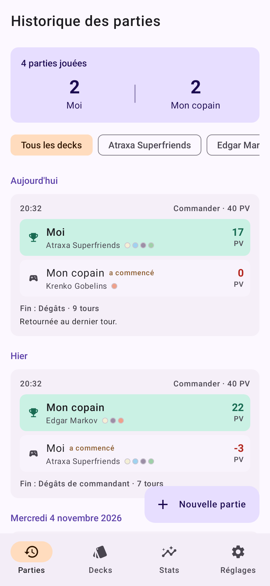
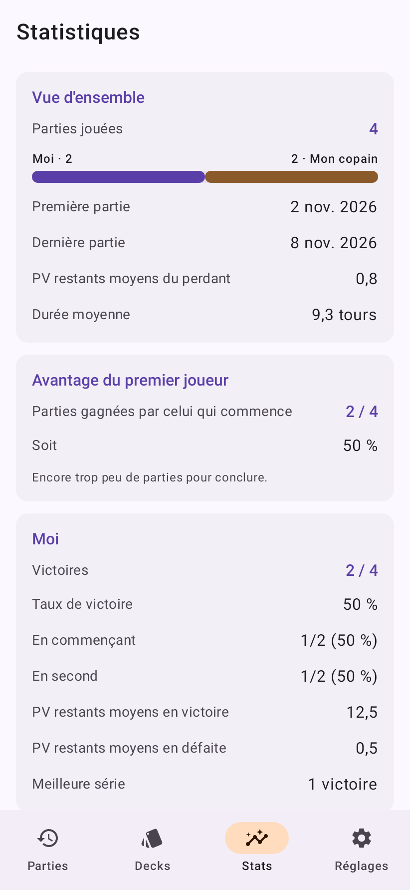
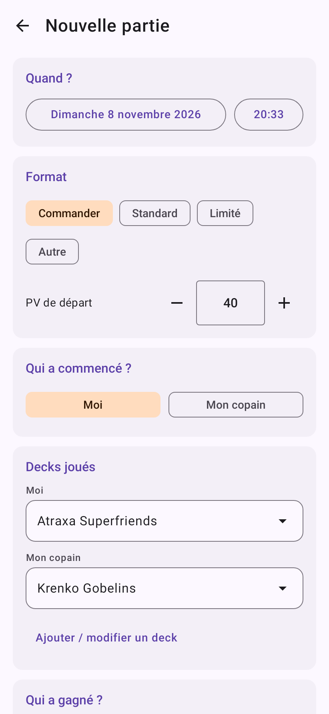

# MTG Duel

Application Android personnelle pour tenir l'historique de vos parties de *Magic: The Gathering* en duel,
à deux joueurs. Pas de compte, pas de serveur, pas de store : un simple APK à installer, toutes les données
restent sur le téléphone.

## Ce que l'app enregistre

Pour chaque partie :

- **la date et l'heure** ;
- **le format** (Commander, Standard, Limité, Autre) et les **PV de départ** ;
- **qui a commencé** la partie ;
- **le deck joué par chacun** ;
- **le vainqueur** ;
- **les PV restants de chaque joueur à la fin**, et en particulier ceux du perdant au moment de la défaite ;
- la façon dont la partie s'est terminée (dégâts, dégâts de commandant, poison, plus de cartes, abandon,
  victoire alternative, autre), le nombre de tours et des notes libres — tous optionnels.

## Aperçu

| Historique | Statistiques | Saisie d'une partie |
| --- | --- | --- |
|  |  |  |

## Les écrans

| Onglet | Contenu |
| --- | --- |
| **Parties** | Le score global entre vous deux, l'historique groupé par jour, un filtre par deck. Un appui sur une partie permet de la corriger ou de la supprimer. |
| **Decks** | Vos decks, classés par propriétaire, avec leurs couleurs et leur bilan victoires/défaites. Un deck déjà utilisé peut être archivé (il disparaît des nouvelles saisies mais reste dans l'historique). |
| **Stats** | Bilan global, avantage réel du joueur qui commence, statistiques par joueur (dont PV restants moyens en victoire et en défaite, meilleure série), classement des decks et confrontations deck contre deck. |
| **Réglages** | Les noms des deux joueurs, l'export/import de sauvegarde JSON, l'effacement de l'historique. |

La saisie d'une partie est optimisée pour l'après-match : les decks de la partie précédente sont
pré-sélectionnés, et choisir le vainqueur remplit automatiquement les PV (PV de départ pour le gagnant,
0 pour le perdant) tant que vous n'avez pas modifié ces champs à la main.

## Installer l'APK

1. Copiez `app-release.apk` sur le téléphone (câble USB, Drive, mail…).
2. Ouvrez le fichier depuis le gestionnaire de fichiers.
3. Android demandera d'autoriser l'installation d'applications provenant de cette source : acceptez
   (*Paramètres → Applications → Accès spécial → Installer des applis inconnues*).
4. Installez. L'application s'appelle **MTG Duel**.

Android 8.0 (API 26) minimum.

## Les données

Tout est stocké dans un fichier JSON du dossier privé de l'application sur le téléphone. Rien ne sort
de l'appareil.

- **Exporter** (Réglages → Sauvegarde) écrit un fichier `mtg-duel-AAAA-MM-JJ.json` où vous voulez.
- **Importer** propose soit de *remplacer* toutes les données, soit de *fusionner* (seules les parties et
  les decks absents sont ajoutés) — pratique pour changer de téléphone ou récupérer la saisie faite sur
  l'autre appareil.

## Reconstruire l'APK

### Avec GitHub Actions

Le workflow `.github/workflows/android.yml` construit l'APK à chaque push et peut être lancé à la main
(onglet *Actions* → *Build APK* → *Run workflow*). L'APK est déposé en artefact téléchargeable.

### En local

Il faut un JDK 17+ et le SDK Android (plateforme 35, build-tools 35).

```bash
echo "sdk.dir=/chemin/vers/android-sdk" > local.properties
./gradlew assembleRelease          # app/build/outputs/apk/release/app-release.apk
./gradlew testDebugUnitTest        # tests : logique, sérialisation, interface (Robolectric)
```

Les tests couvrent les statistiques, la sérialisation des sauvegardes et le parcours complet de
l'interface (créer un deck, saisir une partie, la retrouver dans l'historique et les stats).
`ScreenshotTest` régénère les captures de `docs/screenshots` :

```bash
./gradlew testDebugUnitTest --tests '*ScreenshotTest' -Dmtg.shots.dir=$PWD/docs/screenshots
```

### Clé de signature

**La clé n'est pas dans le dépôt** — une clé de signature est un secret, elle n'a rien à faire
dans Git. Le fichier `keystore/mtgduel.jks` vous a été livré séparément : conservez-le (et son
mot de passe) hors du dépôt, c'est lui qui permet aux futures versions de s'installer **par-dessus**
l'application existante sans perdre les données.

Pour rebâtir un APK signé avec cette clé :

```bash
mkdir -p keystore && cp /chemin/vers/mtgduel.jks keystore/
./gradlew assembleRelease
```

en créant à la racine un fichier `keystore.properties` de quatre lignes :
`storeFile` (chemin vers la clé), `storePassword`, `keyAlias` et `keyPassword`.
Les mêmes valeurs peuvent être passées par les variables d'environnement
`MTG_KEYSTORE_FILE`, `MTG_KEYSTORE_PASSWORD`, `MTG_KEY_ALIAS` et `MTG_KEY_PASSWORD`.

`keystore/` et `keystore.properties` sont ignorés par Git. Sans eux, `assembleRelease` fonctionne
quand même mais signe avec la clé de debug : l'APK s'installe sur un téléphone vierge, pas
par-dessus une version signée avec la vraie clé.

Pour que GitHub Actions signe avec votre clé, ajoutez quatre secrets au dépôt
(*Settings → Secrets and variables → Actions*) :

| Secret | Contenu |
| --- | --- |
| `KEYSTORE_BASE64` | `base64 -w0 keystore/mtgduel.jks` |
| `KEYSTORE_PASSWORD` | le mot de passe du magasin |
| `KEY_ALIAS` | `mtgduel` |
| `KEY_PASSWORD` | le mot de passe de la clé |

Si ces secrets sont absents, le workflow construit un APK signé en debug, ce qui reste parfaitement
utilisable pour tester.

Pour repartir d'une clé neuve :

```bash
keytool -genkeypair -v -keystore keystore/mtgduel.jks -storetype PKCS12 \
  -alias mtgduel -keyalg RSA -keysize 2048 -validity 10950
```

(il faudra alors désinstaller l'ancienne app avant d'installer la nouvelle).

## Faire évoluer l'app

Pile technique : Kotlin, Jetpack Compose (Material 3), navigation-compose, kotlinx.serialization.

```
app/src/main/java/fr/leonelal/mtgduel/
├── data/           modèles, stockage JSON, calculs de statistiques
├── ui/             thème, composants communs, navigation
│   └── screens/    un fichier par écran
└── MainActivity.kt
app/src/test/       tests unitaires (statistiques, sérialisation)
```

Pour publier une nouvelle version, incrémentez `versionCode` et `versionName` dans `app/build.gradle.kts`.
